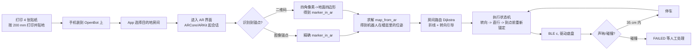

# OpenBene 定点室内导航 Demo（Android + iOS）

在 OpenBot 的 tracking 基础上，用手机 AR 做有限程度的定点导航：机器人的手机上运行本工程的两个 App，识别贴在地面上的打印锚点（二维码 / 图像锚点），把 AR 世界坐标对齐到楼面地图，然后用 Dijkstra 规划房间路线、沿折线行驶，并通过蓝牙 LE 直接驱动 OpenBot 底盘。手机装在机器人上，所以「导航」是机器人自主开过去，App 同时用界面显示转向提示与地图位置。

Android 侧现在有两个工程，方向不同，可以同时安装：

* `New demo/Android`（增强版）：导入楼层地图 JSON，选房间、Dijkstra 规划、多锚点纠偏；
* `New demo/Android-ARIndoorNav`（对标原版 ARIndoorNav）：不导入地图，App 内现场采集一条节点链、之后复现这条链，单锚点 + VIO，没有规划与重定位。详见 [Android-ARIndoorNav/README.md](Android-ARIndoorNav/README.md)。

两个 demo（Android 增强版与 iOS）共用同一套地图、同一套算法和同一份锚点贴纸，只在 AR 定位这一层不同：

| Demo | 平台 | 锚点识别 | AR 定位 |
| --- | --- | --- | --- |
| Android | Kotlin + ARCore | ML Kit 扫二维码载荷（参考 tinhpv/indoor-navigation-system-qrcode-augmented-reality） | ARCore Augmented Image 图像锚点（主）+ 二维码单目解算（备） |
| iOS | Swift + ARKit | Vision 扫二维码载荷 | ARKit ARReferenceImage 图像锚点（主）+ 二维码单目解算（备） |

两边的机器人驱动层都复用 openbene_sdk 里的 ESP32 BLE 协议（服务 `61653dc3-...`、RX `06386c14-...`、TX `9bf1103b-...`、控制帧 `c<left>,<right>\n`、遥测 `v/w/s/b/f`）。

## 两种模式：定点导航与跟随

AR 界面底部有一个 Route / Follow 开关，两种模式共用同一条 BLE 链路和同一套底盘控制量：

* **Route（定点导航）**：识别地面锚点 → 求解 `map_from_ar` → Dijkstra 路线 → 沿折线行驶，途中用锚点修正里程计漂移。目的地只能是地图里已有的房间。
* **Follow（跟随，保留 OpenBot tracking 行为）**：不需要地图、不需要锚点，相机里检测到的目标框直接驱动底盘——框偏左/偏右就原地转向，框比目标高度小就前进，比目标大就停车等待。实现是 `follow.py` / `FollowController.kt` / `FollowController.swift` 三份等价代码：输入一个归一化框（中心 x、中心 y、宽、高）加声呐读数，输出一组左右轮速。

检测源两个平台不同，控制器只吃归一化框，换检测器不用改控制器：

| 平台 | 检测器 | 预设 |
| --- | --- | --- |
| Android | ML Kit 人脸检测（`com.google.mlkit:face-detection`） | `FollowConfig.FACE_BOX`，目标框高度 0.16 |
| iOS | Vision `VNDetectHumanRectanglesRequest`（系统自带，无需模型） | 默认预设，目标框高度 0.55 |

目标框高度是唯一的距离信号，很粗糙：**第一次务必把机器人架空空转**，现场标定 `targetHeight` 再落地。声呐 35 cm 以内 Follow 也会停车，目标丢失 1.5 s 后停车等待。

## 目录结构

```
New demo/
  README.md                 本文件
  docs/map-format.md        地图 JSON 格式说明
  shared/
    maps/demo_floor.json    唯一的楼层地图（4 个锚点、4 个节点、3 条边、2 个房间）
    markers/*.png           4 张可打印锚点贴纸（200 mm，二维码 + 箭头 + 定位角块）
    navcore/                Python 参考实现（路由、引导、位姿估计、执行状态机、跟随、仿真）
    tools/                  生成贴纸 / 生成图标 / 校验地图 / 同步资源 / 校验锚点数学 / 校验跟随参数
  Android/                  Android 增强版工程（Kotlin + ARCore + ML Kit + 人脸检测）
  Android-ARIndoorNav/      Android 对标原版 ARIndoorNav 的减法工程（单锚点 + 节点链，无地图）
  IOS/                      iOS 工程（Swift + ARKit + Vision + CoreBluetooth + 人体检测）
  _ref/qr-nav/              参考仓库的本地克隆，仅作对照，不参与构建
```

## 锚点与坐标系约定（三个实现必须一致）

* 地图坐标系：x 向东、y 向北、yaw 从 +x 逆时针，单位为米，地面为 z = 0。
* `marker.pose` 是贴纸本身在地图里的位姿，`yaw` 表示贴纸图像 **+y 方向**（印刷箭头的方向）。贴纸时要让箭头背向机器人、指向行进方向。
* 每个 `location` 放在对应锚点后方约 1 m 的进近方向上，保证下视相机能看到贴纸。
* AR 观测是三维位姿的水平投影：位置取水平面投影，朝向取重力轴方向的转角。AR 平面坐标系取 `x = AR 世界 x`、`y = -AR 世界 z`，这样绕重力轴的旋转正好是普通二维旋转。
* 图像锚点的朝向约定：ARCore `AugmentedImage.getCenterPose` 与 ARKit `ARImageAnchor` 一致——印刷面落在位姿的局部 X-Z 平面，+X 从左边缘到右边缘，+Y 是贴纸法线（朝上），+Z 从上边缘到下边缘；印刷箭头是图像 +y 轴，所以取局部 **-Z** 作为 `marker_in_ar` 的朝向。二维码那条路用四角解出来的“上边中点减下边中点”方向，两者同源。
* 对齐公式：`map_from_ar = marker.pose ∘ marker_in_ar⁻¹`，之后每一帧 `pose = map_from_ar ∘ device_in_ar`；每次识别到锚点都会把漂移清零。

## 运行流程



执行状态机（`shared/navcore/openbene_nav/executor.py`、`nav/RouteExecutor.kt`、`Nav/RouteExecutor.swift` 三份等价实现）：

* `DRIVING`：朝当前航点转向（误差大于 15° 原地转），然后按 `steerGain * headingError` 做差速前进，巡航速度 0.35。
* 每条腿结束时如果还没有该锚点的修正，进入 `SCANNING`：原地旋转最多 30 s 找锚点，找不到则 `FAILED`。
* 声呐 35 cm 内 `BLOCKED` 停车，50 cm 以上自动恢复。
* bumper 触发 → `FAILED`，必须人工清障后重新开始。
* 里程计累计漂移超过 4 m 且附近有锚点 → 主动重新锚定。

## 快速验证（不需要手机，本机可跑）

```bash
# 1. 校验地图
python shared/tools/validate_map.py

# 2. 运行参考实现：仿真机器人从入口开到 Room 101 / Room 102
cd shared/navcore
python run_demo.py --destination "Room 101"
python run_demo.py --destination "Room 102"
python run_demo.py --destination "Room 101" --obstacle   # 走廊上放障碍，验证停车与恢复

# 3. 全部单元测试（86 个，含跟随控制器）
python -m unittest discover -s tests -t .

# 4. 资源一致性：shared/ 与两个 App 里的地图、贴纸是否同步
python shared/tools/sync_demo_assets.py --check

# 5. 原生源码结构检查（括号/字符串配对，本机没有 Kotlin/Swift 编译器时的最低保障）
python shared/tools/check_source_syntax.py

# 6. 跟随控制器三份实现的参数与文案是否一致（静态比对 follow.py / FollowController.kt / FollowController.swift）
python shared/tools/verify_follow_parity.py
```

参考结果：Room 101 路线 `loc_entrance -> loc_junction -> loc_room101`，10.0 m，引导为 `Forward 6.0 m, then turn left at Corridor Junction` 与 `Forward 4.0 m, then arrive at Room 101`；Room 102 为 12.0 m 直行。仿真实测到达用时约 50 s / 60 s，位置误差 0.04 m，3 次锚点修正。

`shared/tools/verify_marker_math.py` 用合成针孔相机验证二维码单目解算：给定真实贴纸位姿投影出四角像素，再让解算器反推位姿，检查误差。同一套数学被移植到 Kotlin（`MarkerGeometry.kt`）与 Swift（`MarkerGeometry.swift`），三份实现对同一场景给出同样结果（对应测试 `shared/navcore/tests/test_marker_math.py`）。脚本还会按 ARCore/ARKit 的图像锚点约定造一个位姿再投影回平面，往返误差为 0，保证“图像锚点”与“二维码”两条路给出同一个 `marker_in_ar`。

## Android 构建与运行

1. 已在本机实际编译通过（Gradle 8.10.2 + AGP 8.5.0 + Kotlin 1.9.24 + JDK 17 + Android SDK 34），产物是 `Android/app/build/outputs/apk/debug/app-debug.apk`（约 63 MB）。命令行复现：

   ```bash
   cd Android
   gradle --no-daemon :app:assembleDebug   # Android Studio 也可以直接打开本目录
   adb install -r app/build/outputs/apk/debug/app-debug.apk
   ```

   仓库里没有 wrapper 的 jar，所以本机直接用系统 Gradle；换机器构建时可以 `gradle wrapper` 先生成 wrapper 再 `./gradlew :app:assembleDebug`。

2. 设备要求：支持 ARCore 的 Android 手机（ARCore 由 Play Store 的 “Google Play Services for AR” 提供），Android 7.0 (API 24) 以上。
3. 权限：相机（AR 与扫码）、蓝牙（驱动 OpenBot）；Android 11 及以下还需要位置权限用于 BLE 扫描。
4. 运行：手机装到 OpenBot 上 → 打开 App → 选择目的地 → 打开 “Drive a real OpenBot over Bluetooth LE” → 点 “Scan for OpenBot” 选中设备（名称包含 OpenBot / RTR_520）→ “Start AR navigation” → 看到 `localised. Tap Start driving.` 后点 “Start driving”。
5. 跟随模式：AR 界面底部把开关切到 “Follow mode”，把操作者放在相机前面，再点 “Start driving”。跟随不需要定位，所以没看到锚点也能启动；机器人会保持目标框居中并维持距离。
6. 不想接机器人时不要打开蓝牙开关，App 会用 mock link：只把控制量显示在界面上，可以手持手机在贴纸间移动来验证整套导航逻辑。

### 对标原版 ARIndoorNav 的 Android 工程

`Android-ARIndoorNav/` 是上面这个工程的减法副本：去掉地图 JSON、Dijkstra、多锚点重定位、二维码解码与 4 张 OpenBene 贴纸，锚点换成原版的两张参考图（`pi` 3 in 宽、`1` 5 in 宽），流程改成"现场采集一条节点链 → 之后复现这条链"。它同样在本机编译通过（产物 `Android-ARIndoorNav/app/build/outputs/apk/debug/app-debug.apk`，约 48 MB），包名 `com.openbene.arindoornav`，可与增强版同时安装。功能边界、操作步骤、打印尺寸、测试清单与已知限制见 [Android-ARIndoorNav/README.md](Android-ARIndoorNav/README.md)。

图像锚点数据库是 App 启动时用 `assets/markers/*.png` 现建的（`AugmentedImageDatabase.addImage`），不需要额外工具。如果想让 ARCore 用离线特征库（更稳），可以：

```bash
arcoreimg build-db --input_images=shared/markers --output=Android/app/src/main/assets/markers.imgdb
```

并把 `markers.imgdb` 改成用 `AugmentedImageDatabase.deserialize` 加载（`ArNavigationActivity.buildMarkerDatabase` 里留了位置）。

## iOS 构建与运行

1. 在 macOS 上安装 Xcode 15 与 [XcodeGen](https://github.com/yonaskolb/XcodeGen)：

   ```bash
   brew install xcodegen
   cd IOS && xcodegen generate && open OpenBotAnchorNav.xcodeproj
   ```

   然后选真机（ARKit 需要真机，模拟器没有 AR）运行。`project.yml` 里 `OpenBotNavKit` 是一个 framework target，App 与单元测试 target 都链接它，逻辑只有一份。

2. 只跑算法测试（不需要真机）：

   ```bash
   cd IOS && swift test
   ```

3. 权限：相机、蓝牙（CoreBluetooth 会弹窗）。Info.plist 已写好说明文案，方向锁定竖屏。
4. 参考图像（`ARReferenceImage`）在运行时用 `Resources/markers/*.png` 现建，物理宽度取地图里的 `size_m`（0.2 m），不需要 ARKit 的离线扫描工具。
5. 跟随模式：AR 界面底部的 Route / Follow 分段控件切到 Follow，把操作者放在相机前面，再点 “Start driving”。目标框来自 Vision 的人体矩形检测，和二维码扫描共用同一帧相机图像，不需要地图与锚点。

## 硬件与场景准备

1. `python shared/tools/make_markers.py` 生成 4 张贴纸，**按 200 mm 正方形打印**（贴纸上的文字会写出尺寸），贴到地面时箭头指向行进方向。
2. 地面尽量平整、光线均匀；避免强反光与大面积纯色地面，AR 需要纹理。
3. 相机要能看到地面贴纸：把手机固定在机器人上，镜头朝前下方约 30-45°。
4. 地图默认尺寸为 12 m x 4 m 的走廊加两个房间，按 `docs/map-format.md` 改成自己的场地，然后重新生成贴纸、跑测试、同步资源。

## 安全须知

* 第一次务必**把机器人架空空转**，确认轮子转向、急停、BLE 连接都正常再落地。
* 保持声呐避障开启（本工程依赖固件上报的 `s` 与 `b`）；`BLOCKED` 会自动停车，`bumper` 会直接进入 `FAILED`。
* 随时可以按 “Stop”：会立刻发 0 速度并结束 AR 会话（会话中断/失败时也会自动停车）。
* ARCore/ARKit 的跟踪状态不是正常时会先停车等它恢复（跟随模式只用相机画面，不受影响）；恢复跟踪后执行器会从当前航点继续。
* 走廊上有人或宠物时不要启动；巡航速度 0.35（约为满速的一半）。

## 原版 ARIndoorNav（先行验证）

按约定，原版（2021 Firebase 版）作为未修改快照放在 `ARIndoorNav-original/`：先跑通它的「单锚点采集 + 导航」，本目录的增强版（Android / IOS）本轮保持原样、暂不测试。原版的功能界定、局限清单、Mac 编译与测试步骤都在 [ARIndoorNav-original/HANDOVER.zh-CN.md](ARIndoorNav-original/HANDOVER.zh-CN.md)。

## 已知限制与验证状态

* Android 侧另有对标原版 ARIndoorNav 的减法工程 `Android-ARIndoorNav/`：本机编译通过（约 48 MB 的 debug APK），只验证到编译与打包，装机运行仍需现场验证；其功能边界与测试清单见该目录 README。
* 本工程在 Windows 上开发：**Python 参考实现与全部 86 个测试、地图校验、资源同步、锚点数学、原生源码结构检查都在本机跑通**；**Android 工程已在本机用 Gradle 8.10.2 + AGP 8.5.0 + Kotlin 1.9.24 + JDK 17 实际编译通过**，产物为 `Android/app/build/outputs/apk/debug/app-debug.apk`。本机没有连接 Android 设备，所以还没有装机运行验证。iOS 工程（含跟随模式）在本机没有 Xcode 的情况下写成，内核另有 38 个 `swift test` 用例，**尚未编译**，请在 Xcode 里首次构建时留意报错。
* 有限定点导航：只支持地图里已有的房间与节点，没有避障重规划，没有动态障碍绕行；走廊里出现新障碍时靠声呐停车等待人工清障。
* 二维码备用解算依赖印刷尺寸（`MarkerGeometry.DEFAULT_CODE_QUAD_SIZE_M = 0.12`，即含静区的二维码块宽）与相机内参，位置精度约 ±10-15%，航向在机器人正对贴纸时可信；图像锚点路径没有这个问题。两条路径的取舍与公式都写在 `shared/navcore/openbene_nav/marker_math.py` 的模块注释里。
* 跟随模式只跟一个目标：控制器取画面里最大的框，多人同框时会来回切换；目标框高度当距离用，换相机倾角或换人之后要重新标定 `targetHeight`。
* 提交状态：`New demo/` 已入库并推送到 `HeyBene/OpenBene` 的 `main` 分支；`_ref/`（参考仓库克隆）与各工程里的 `local.properties`、`local-mirror.init.gradle` 是本机专用文件，已列进 `.gitignore`。
