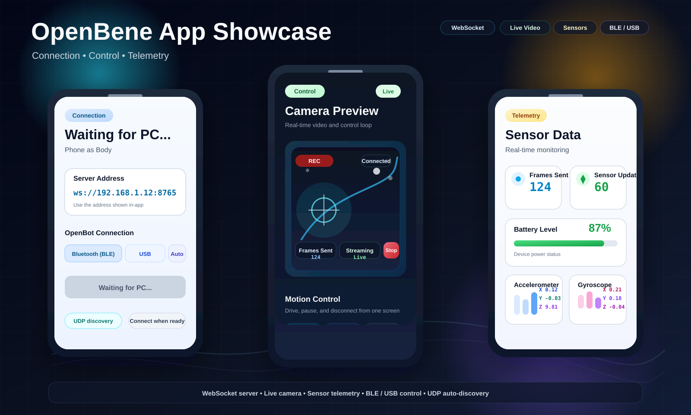
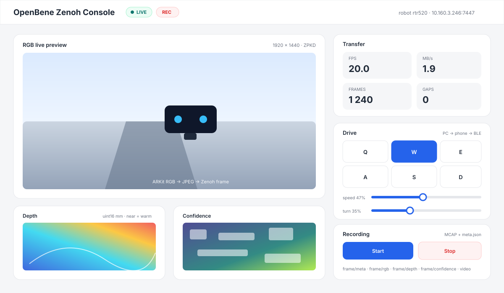

# OpenBene

<p align="center">
  
  
</p>

<p align="center"><strong>语言 / Languages:</strong> <a href="README.md">English</a> | 简体中文</p>

<p align="center"><strong>Phone as Body, PC as Brain</strong> - 面向 OpenBot 机器人工作流的公共平台层工具库。</p>

> 范围说明：
> `OpenBene` 是公开的平台层仓库。
> ROS2、建图、定位和其他内部 mobility 内容会在整理后按需下放。
> 参见 [docs/OPENBENE_SCOPE.md](docs/OPENBENE_SCOPE.md)。

## 概览

OpenBene 主要提供这些能力：

- 机器人控制用 Python SDK
- OpenBot 风格手机端工作流
- WebSocket 连接与自动发现
- 视频、传感器和录制支持
- 面向 ESP32 / OpenBot 的 BLE 手动控制工具
- Zenoh 传输预览：Android / iOS SDK 与 PC 控制台，面向高频画面、深度与位姿

## 应用展示

<p align="center">
  
</p>

这张预览展示了已经导入到 `apps/robot_app/` 的机器人侧界面：

- 连接状态与 `Server Address`
- 实时 `Camera Preview`
- `Sensor Data`，包括 `Frames Sent`、`Sensor Updates`、`Battery Level`、`Accelerometer` 和 `Gyroscope`
- WebSocket、UDP 自动发现，以及 BLE / USB 控制链路

## Zenoh 传输（预览）

第二条面向高频机器人数据的数据面。上面的 WebSocket 链路原样保留，Zenoh 负责把同一时刻的
RGB、深度、置信度、位姿和元数据装进一条消息，并把整段会话录成 MCAP。

<p align="center">
  
</p>

| 组成 | 位置 | 技术栈 |
| --- | --- | --- |
| Android SDK 与验证 App | `zenoh_android/`，`feature/zenoh-android-transport` 分支 | Kotlin + 官方 `zenoh-kotlin-android` 1.10.2 JNI，Android 11+ |
| iOS SDK 与验证 App | `zenoh_ios/`，`feature/zenoh-ios-transport` 分支 | Swift Package + SwiftUI + `zenoh-pico` 1.1.0，iOS 16+ |
| PC 控制台 | `zenoh_ios/pc` | Python 3.10+、`eclipse-zenoh`、MCAP |

两端的 key 和二进制帧完全一致，一套控制台可以同时收 Android 手机和 iPhone：

```text
openbene/{robot}/cmd        PC -> 手机   drive / stop
openbene/{robot}/status     手机 -> PC   在线状态，2 秒心跳
openbene/{robot}/sensors    手机 -> PC   加速度、陀螺仪、电量
openbene/{robot}/telemetry  手机 -> PC   电压、轮速、声呐
openbene/{robot}/video      手机 -> PC   ZFRM：20 字节头 + JPEG
openbene/{robot}/frame      手机 -> PC   ZPKD：RGB + 深度 + 置信度 + 位姿 + 元数据
openbene/{robot}/session    手机 -> PC   录制开始 / 停止
```

手机端装好验证 App 后，把控制台打印的地址（例如 `10.160.3.246:7447`）填进 App。
PC 端一条命令同时拉起 router、控制台和预览页：

```powershell
zenoh_ios\scripts\run-pc.cmd
```

```bash
python zenoh_ios/scripts/run_pc.py
```

控制台在 <http://127.0.0.1:8080/>，可以看和做这些事：

- RGB 按到达帧率实时预览，旁边是深度和置信度平面
- `帧率`、`带宽`、已收帧数和 `frame_id` 跳号，链路质量一眼可见
- `W A S D` 控制前后左右，`Q E` 走弧线，`空格` 停车；屏幕上的方向键和速度 / 转向滑杆等价
- `开始录制` / `停止录制` 写出 MCAP 和 `*.mcap.meta.json` 汇总，文件在 `zenoh_ios/runs`

要并进 Flutter App，用 platform channel 把原生传输包一层：命令走 `MethodChannel`，
画面走 `EventChannel`。

## 从这里开始

- PC 端 Python 控制：[openbene_sdk/README.md](openbene_sdk/README.md)
- 手机端 UI：[openbot-mobile-control/README.md](openbot-mobile-control/README.md)
- 导入的机器人 App：[apps/robot_app/README.md](apps/robot_app/README.md)
- 仓库地图与边界：[docs/architecture.md](docs/architecture.md)

## 工作区分层

- 主线公开内容：`openbene_sdk/`、`openbot-mobile-control/`、`apps/robot_app/`、`openbot/`、`docs/`
- 应用目录：`apps/`，用于放置独立的 Flutter 应用
- 辅助本地工作区：`openbene_mobility/`、`openbene_local/`

## 结构图

```text
OpenBene/
- docs/
- openbene_sdk/
- openbot/
- openbot-mobile-control/
- apps/
  - robot_app/
- zenoh_android/          # Zenoh Android SDK 与验证 App（功能分支）
- zenoh_ios/              # Zenoh iOS SDK、验证 App 与 PC 控制台（功能分支）
- openbene_mobility/
- openbene_local/
```

## 文档

- [docs/architecture.md](docs/architecture.md) - 架构与新手入口
- [openbene_sdk/README.md](openbene_sdk/README.md) - SDK 文档
- [apps/robot_app/README.md](apps/robot_app/README.md) - 导入的机器人 App 文档
- [openbot-mobile-control/releases/README.md](openbot-mobile-control/releases/README.md) - Android 版本与发布说明
- [docs/WINDOWS_BLE_CONTROL_RUNBOOK.md](docs/WINDOWS_BLE_CONTROL_RUNBOOK.md) - Windows BLE 控制流程
- [docs/OPENBENE_SCOPE.md](docs/OPENBENE_SCOPE.md) - 公共范围边界
- [zenoh_android/README.md](https://github.com/HeyBene/OpenBene/blob/feature/zenoh-android-transport/zenoh_android/README.md) - Android Zenoh SDK、验证 App 与 Windows 启动脚本
- [zenoh_ios/README.md](https://github.com/HeyBene/OpenBene/blob/feature/zenoh-ios-transport/zenoh_ios/README.md) - iOS Zenoh SDK、验证 App 与 PC 控制台
- [Zenoh 评估与实施计划](https://github.com/HeyBene/OpenBene/blob/docs/zenoh-transport-plan/docs/ZENOH_TRANSPORT_ASSESSMENT_AND_PLAN.md) - 为什么换、利弊与迁移步骤
- [PROJECT_CONTEXT.md](PROJECT_CONTEXT.md) - 兼容指路页

## 许可证

MIT License。详见 [LICENSE](LICENSE)。
