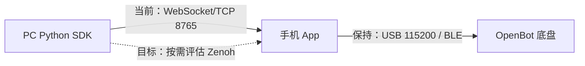

# 手机与 PC 链路改用 Zenoh 的评估与实施计划

## 1. 结论

把 PC 与机器人手机之间的 WebSocket 换成 Zenoh 在技术上可行，底盘侧的 USB 串口和 BLE 不需要改动。Zenoh 能改善视频、控制与遥测共用一条连接时的相互干扰，也能为多订阅者、多机器人以及 ROS 2 对接留出空间。

当前不建议直接整体替换。单机器人、单 PC、同一局域网的场景中，协议本身通常不是主要瓶颈。现有链路的 Base64/JSON 包装、单条 TCP 连接和“只允许一个 PC 客户端”的限制，会先抵消掉一部分 Zenoh 带来的收益。

建议按以下顺序推进：

1. 建立可重复的延迟、抖动和丢帧基线。
2. 先完成 WebSocket 二进制视频、通道隔离和可丢帧策略，排除实现层瓶颈。
3. 在 PC 与 Android 手机之间做一个只覆盖控制、传感器和视频的最小 Zenoh 验证。
4. 使用相同硬件、分辨率、码率和 WiFi 条件做 A/B 对比，按明确门槛决定是否切换。
5. 切换时保留 WebSocket 回退，先以单机器人和主 App 灰度，再扩大范围。

本计划的迁移范围仅包括 PC 与手机之间的 WiFi 链路：



手机到 OpenBot 底盘的 USB/BLE 协议不在本次替换范围内。

## 2. 当前链路和已知瓶颈

当前实现具有以下特点：

- 手机作为 WebSocket 服务端，PC 作为客户端连接 `ws://<phone>:8765`。
- 驱动命令、停止命令、心跳、视频帧、手机 IMU 和电量等数据共用一条连接。
- 视频帧经过 JPEG 编码、Base64 编码并放入 JSON 字符串发送。
- 手机端目前只接受一个 PC 客户端，第二个连接会被拒绝。
- UDP 12345 只用于发现，没有承担控制或视频传输。
- 手机到 ESP32/Arduino 继续使用行文本协议，不经过 PC 的 WebSocket。

这意味着替换 Zenoh 时，需要同时设计以下内容，难以只更换端口号：

- 视频的二进制承载和丢帧策略。
- 控制、遥测和视频的独立 key 与独立 QoS。
- 手机作为发布者还是服务端的连接模型。
- 连接发现、重连、心跳和旧命令失效处理。
- 现有 SDK 和 App 的兼容接口。

当前可观察到的主要性能风险，按预期影响排序如下：

| 风险 | 当前原因 | 换 Zenoh 是否自动解决 |
|---|---|---|
| 视频帧体积偏大 | Base64 增加约三分之一体积，JSON 还要转义和分配字符串 | 否。必须改为二进制 payload |
| 控制被视频阻塞 | 同一 TCP 连接、同一发送队列 | 部分。需要独立 QoS 或独立 transport |
| 控制命令变旧 | 没有统一序号、过期时间或优先丢弃策略 | 否。需要在协议语义中补上 |
| 手机只接受一个 PC | 服务端显式拒绝第二客户端 | 是。发布/订阅天然支持多订阅者 |
| 发现依赖局域网广播 | 自定义 UDP 广播，可能被 AP 隔离或防火墙拦截 | 部分。Zenoh scouting 也可能受同样限制 |
| WiFi 空口拥塞 | 共享信道、重传和管理帧 | 否。上层协议无法消除物理层限制 |

## 3. Zenoh 方案的收益

### 3.1 数据通道可以解耦

建议使用键空间表达数据语义，而不是把所有内容塞进一个 JSON 消息：

```text
openbene/{robot_id}/cmd
openbene/{robot_id}/video
openbene/{robot_id}/sensors
openbene/{robot_id}/telemetry
openbene/{robot_id}/status
openbene/{robot_id}/config
```

控制命令可以使用可靠传递并设置较短的生命周期；视频可以使用 best-effort 或带超时的可靠策略，拥塞时丢弃旧帧；传感器与状态可以使用周期性采样和最新值语义。

### 3.2 QoS 和背压策略更明确

Zenoh 可以按 key 配置 reliability、congestion control、priority 和 express 等行为。对机器人链路，关键不是把所有数据都做到“可靠”，而是：

- 控制命令必须及时到达，过期命令宁可丢弃也不要在队列里排队。
- 视频允许丢帧，避免每一帧都占满发送队列。
- 状态和传感器保留最新值，避免消费端处理历史积压。

这比当前单一 WebSocket 发送队列更符合实时控制的语义。

### 3.3 多订阅者和多机器人扩展更自然

当前手机 App 只接受一个 PC 客户端。Zenoh 的发布/订阅模型可让以下消费者同时工作：

- PC 控制程序；
- 数据采集或录制进程；
- 可视化或监控页面；
- 远程运维工具；
- ROS 2 侧的桥接节点。

多机器人也可以通过 `{robot_id}` 命名空间隔离，不必为每台机器人复制一套发现和连接管理逻辑。

### 3.4 与 ROS 2 的衔接更清晰

如果后续需要把手机侧的 RGB、深度、位姿或底盘遥测送入 ROS 2，Zenoh 可以通过 ROS 2 与 DDS 的桥接组件减少自研转发层。这个收益属于 mobility 和集成场景，不应作为当前单机遥控链路切换 Zenoh 的唯一理由。

### 3.5 为未来的远程访问留出入口

Zenoh 支持 peer、client 和 router 等拓扑。后续若需要跨网段、云端汇聚或多机管理，可以增加 router 和访问控制，而不必重写手机与 PC 的业务层。当前阶段仍应优先验证同一局域网下的基础链路。

## 4. Zenoh 方案的成本与风险

### 4.1 Flutter 缺少现成的原生客户端路径

现有两个 Flutter App 都使用 Dart 的 `web_socket_channel`。仓库内没有 Zenoh 依赖或桥接实现，采用前还需要确认可维护的 Dart/Flutter 接入方式。迁移通常需要新增 Android 和 iOS 原生代码，例如通过 JNI、C ABI 或 FFI 调用 Zenoh 客户端，再由 MethodChannel/EventChannel 暴露给 Flutter。

这会带来以下工作：

- Android 和 iOS 两套构建与打包配置；
- 原生库体积、ABI 覆盖和最低系统版本管理；
- 后台运行、网络权限和生命周期处理；
- 原生层与 Dart 层之间的线程、缓冲和错误传播；
- iOS 真机与 App Store 分发前的依赖审核。

这是本方案最大的工程成本，也是不能把它当作“替换 URL”的原因。

### 4.2 仍然依赖 WiFi 物理条件

Zenoh 不能消除共享空口、信道干扰、AP 客户端隔离、路由重传和手机省电策略带来的问题。如果视频已经占满上行带宽，换协议后仍然会掉帧或增加延迟。

### 4.3 单条 TCP transport 不能自动消除队头阻塞

如果 Zenoh 仍把所有 key 复用到一条 TCP 连接上，并且不配置独立的丢弃和优先策略，视频大帧仍可能推迟控制消息。要达到隔离效果，需要显式配置 QoS，必要时让视频使用不同的 transport 或链路。

### 4.4 连接模型和协议语义都会变化

WebSocket 当前是明确的“手机服务端、PC 客户端”。Zenoh 是发布/订阅，需要重新定义：

- 机器人身份和 key 命名；
- 控制命令的序号、时间戳和过期时间；
- 断线期间是否保留消息；
- 重连后是否补发历史帧；
- 谁负责心跳和在线状态；
- 发现失败时如何手工指定 endpoint。

这些问题如果没有先定义，迁移后可能出现“能连上但控制不跟手”或“断线后执行旧命令”的新故障。

### 4.5 运维和调试门槛上升

WebSocket 可以用浏览器、`wscat` 和简单 Python 脚本直接检查。Zenoh 需要额外掌握 `z_pub`、`z_sub`、router 配置、scouting 和 QoS 参数。现场排障时，需要同时排查 WiFi、Zenoh 路由、key 匹配和手机原生桥接。

### 4.6 双栈维护和回滚成本

迁移期间需要同时维护 WebSocket 与 Zenoh 两条链路。至少要保留：

- 旧 App 和新 App 的协议兼容；
- SDK 的自动发现回退；
- Zenoh 不可用时的 WebSocket 回退；
- 两套日志和诊断信息。

如果没有明确的下线时间，双栈会长期增加测试矩阵。

### 4.7 安全边界需要重新设计

当前 WebSocket 链路没有 TLS、身份认证或细粒度访问控制。Zenoh 本身也不等于自动安全。迁移到多订阅者或 router 后，必须明确：

- 是否启用 TLS 或双向认证；
- 哪些 key 允许远程写入；
- 控制命令的发布者如何授权；
- 发现和路由是否暴露到不可信网络；
- 日志中是否会出现 IP、设备名或控制数据。

## 5. 预期效果

下表是定性判断，最终以第 7 节的实测数据为准。

| 场景 | 继续 WebSocket，先做二进制和分通道 | 直接换 Zenoh | 结论 |
|---|---|---|---|
| 单机器人、单 PC、局域网 | 改动小，通常能明显减少视频开销 | 能工作，但协议收益有限，移动端成本高 | 先优化 WebSocket |
| 视频阻塞控制 | 独立连接或优先队列即可改善 | 独立 key 与 QoS 更系统 | Zenoh 有优势 |
| 多消费者同时看视频/遥测 | 需要自建转发或改单客户端限制 | 发布/订阅直接支持 | Zenoh 明显有优势 |
| 多机器人统一管理 | 每台一套连接与发现 | key 命名空间和路由更自然 | Zenoh 明显有优势 |
| ROS 2/DDS 集成 | 需要自研桥接 | 可用现成桥接路径 | Zenoh 明显有优势 |
| 弱网和跨网段 | 需要额外中继和重连逻辑 | router 拓扑更合适 | 需实测 |
| 纯 iOS/Flutter 快速交付 | 原生能力成熟 | 需要新增原生依赖和桥接 | WebSocket 风险更低 |

## 6. 推荐的目标架构

### 6.1 保持上层 API 不变

PC 侧应把传输实现放在现有连接层，而不是让电机、视频、传感器模块直接依赖 Zenoh。建议新增与现有 WebSocket 连接同接口的适配器，使以下调用保持稳定：

```python
bot.forward(0.5)
bot.stop()
frame = bot.get_frame()
sensors = bot.get_sensors()
```

连接层负责消息编解码、重连和 QoS；业务模块继续使用 `send()`、`on_message()` 这类抽象。

### 6.2 视频使用二进制 payload

无论最终使用 WebSocket 还是 Zenoh，视频都不应继续使用 Base64 JSON。建议定义明确的二进制帧格式：

```text
magic(4) | version(1) | flags(1) | header_length(2) |
timestamp_ns(8) | frame_id(8) | width(2) | height(2) |
format(1) | payload_length(4) | jpeg_payload
```

第一版可以只发送 JPEG 字节和最小头部，后续再增加深度或压缩格式。接收端按时间戳丢弃过期帧。

### 6.3 控制命令具备新鲜度语义

控制消息至少包含：

- `robot_id`；
- `sequence`；
- `sent_at`；
- `ttl_ms`；
- 左右轮目标值；
- 控制模式。

接收端应拒绝过期命令和乱序旧命令，并保持现有心跳停车语义。视频发送队列不得阻塞控制发布。

### 6.4 连接发现和回退

- 局域网优先使用发现；发现失败时允许手工填写 IP 或 endpoint。
- 保留 UDP 发现作为兼容路径，但不要让它成为唯一入口。
- Zenoh 启动失败时自动回退 WebSocket，并在 UI 中显示当前 transport。
- 重连要区分“网络暂时不可用”和“认证或配置错误”，避免无限重试掩盖问题。

## 7. 分阶段实施计划

### 阶段 0：基线测量与协议冻结

目标：先知道当前链路到底慢在哪里。

工作内容：

- 在 PC 侧增加可选的传输日志：消息类型、发送时间、接收时间、字节数、队列长度和丢弃数。
- 在 App 侧记录相机采集、JPEG 编码、发送、接收和显示时间。
- 固定测试条件：同一手机、同一 PC、同一 WiFi 频段、同一分辨率、同一 JPEG 质量和同一码率。
- 定义 WebSocket 现有消息的兼容基线，记录发现的 JSON schema 和错误行为。

验收标准：

- 能输出控制命令 p50/p95/p99 延迟。
- 能输出视频帧端到端延迟、帧率和丢帧率。
- 能输出传感器消息间隔和抖动。
- 能在不连接底盘的情况下复现测试。

### 阶段 1：先优化 WebSocket 基线

目标：排除实现层开销，让后续 Zenoh 对比具有意义。

工作内容：

- 视频从 Base64 JSON 改为 WebSocket binary frame。
- 控制/状态与视频使用独立发送队列；条件允许时使用独立连接。
- 视频使用“只保留最新帧”或有限长度队列，拥塞时丢弃旧帧。
- 给控制命令增加序号、时间戳和过期时间。
- 把传输逻辑从 `NetworkService` 中抽出，形成可替换接口。

验收标准：

- 相同画质下视频带宽明显下降。
- 视频拥塞时控制命令 p95 延迟不随视频帧堆积线性增长。
- 停止命令仍能在断线或心跳超时后可靠停车。
- 旧版客户端能够通过兼容路径继续工作，或明确记录不兼容版本。

这一阶段本身就可能解决大部分现场问题。若阶段 3 的 Zenoh 验证没有超过本阶段基线，应停止迁移。

### 阶段 2：Zenoh 最小技术验证

目标：验证 PC 到 Android 手机的单机器人链路，不修改正式 App 的默认行为。

范围：

- PC 使用 Python Zenoh 客户端。
- Android 手机增加实验性原生桥接。
- 只支持一个机器人、一个局域网、一个控制订阅者。
- 先传控制、状态、传感器和二进制视频，不接入底盘。

工作内容：

- 确认可用的 Zenoh 版本和移动端绑定方式，锁定版本。
- 设计 key 命名、消息头、序列化和错误码。
- 实现 peer 或 client 拓扑的最小连接，记录 scouting 失败时的手工 endpoint 方式。
- 为控制设置可靠、低延迟和过期丢弃策略。
- 为视频设置可丢帧策略，验证不会阻塞控制。
- 增加 `z_pub`/`z_sub` 之外的应用级诊断日志。

验收标准：

- 手机与 PC 能稳定建立和重建会话。
- 控制命令端到端延迟和阶段 1 基线可比。
- 视频拥塞时控制不被明显拖慢。
- 手机原生桥接退出、切后台和网络切换后不残留线程或连接。
- 不引入未处理的权限崩溃、ABI 缺失或启动失败。

### 阶段 3：A/B 基准测试与决策

目标：用数据决定是否进入正式迁移。

测试矩阵至少包括：

- 2.4 GHz 与 5 GHz；
- 近距离与隔墙或弱信号；
- 静止与移动；
- 单人订阅与多订阅者；
- 视频开/关；
- Android 与 iOS（若 iOS 桥接已具备）；
- 正常断网、切网和重连。

核心指标：

- 控制命令 p50/p95/p99 延迟；
- 视频端到端延迟、帧率、卡顿和丢帧率；
- 传感器消息抖动；
- 手机和 PC 的 CPU、内存和耗电；
- 首连时间、重连时间和断线恢复成功率；
- 安装包体积和冷启动时间。

建议的继续条件：

- 控制 p95 不劣于阶段 1 基线，或只在多订阅者场景下有小幅增加；
- 视频拥塞时控制延迟不出现数量级恶化；
- 视频带宽不高于阶段 1 的二进制 WebSocket；
- 手机 CPU 和耗电在可接受范围；
- 断线重连成功率不低于现有实现；
- 移动端构建、签名、安装和后台行为可稳定复现。

任一关键条件不满足，应保留 WebSocket，并把 Zenoh 作为可选的多订阅者或 ROS 2 集成路径。

### 阶段 4：正式接入与灰度

仅在阶段 3 通过后执行。

工作内容：

- 把传输适配器接入 SDK 的连接工厂，保持上层 API 稳定。
- App 增加 transport 选择，默认跟随已发布配置，不强制用户手工切换。
- 增加 Zenoh 与 WebSocket 的自动回退。
- 统一日志和诊断页，显示当前传输、endpoint、重连次数和丢弃统计。
- 更新 README、SDK API 文档、部署说明和 CHANGELOG。
- 保留至少一个版本的 WebSocket 回退窗口。

验收标准：

- 默认路径在无配置、无发现、弱网和重连场景均可工作。
- 回退路径经过实际断网演练。
- 旧版 App 或旧版 SDK 的行为有明确兼容说明。
- 没有把敏感地址、密钥或设备信息写入默认日志。

### 阶段 5：扩大范围与清理

工作内容：

- 在单机器人稳定后验证多机器人和多订阅者。
- 根据实际需求接入 ROS 2 桥接，不把 mobility 研究代码混入平台层。
- 评估是否需要 router、TLS、双向认证和远程访问策略。
- 统计真实使用情况，再决定 WebSocket 的退役时间。

验收标准：

- 多机器人 key 隔离和权限边界经过测试。
- 远程连接具备明确的认证和授权策略。
- 回退路径有下线计划，或明确长期保留。

## 8. 代码影响范围

预期需要改动的区域：

| 区域 | 预期改动 | 风险 |
|---|---|---|
| `openbene_sdk/src/openbene/connection.py` | 抽象连接接口，新增 Zenoh 适配器 | 中 |
| `openbene_sdk/src/openbene/openbene.py` | 通过工厂选择 transport，保持公开 API | 中 |
| `openbene_sdk/src/openbene/video.py` | 支持二进制帧和时间戳丢弃 | 中 |
| `openbene_sdk/src/openbene/sensors.py` | 解析新的遥测 key 和消息格式 | 中 |
| `openbot-mobile-control/lib/services/network_service.dart` | 拆分传输层，解除单客户端限制 | 高 |
| `openbot-mobile-control/lib/services/camera_service.dart` | 输出二进制帧而非 Base64 JSON | 中 |
| `apps/robot_app/lib/services/` | 同步传输适配和回退逻辑 | 高 |
| Android/iOS 原生目录 | Zenoh 绑定、权限、打包和生命周期 | 高 |
| `docs/`、README、CHANGELOG | 协议、部署和兼容说明 | 低 |

`openbene_mobility/` 和 ROS 2 桥接仍应遵守现有 scope 规则。Zenoh 是可复用的平台传输能力，可以进入 `OpenBene`；建图、定位和内部实验留在 mobility 工作区。

## 9. 风险控制

- 每个阶段独立可回退，不在一个提交中同时改协议、视频格式和底盘通信。
- 控制链路优先于视频链路，任何优化都不能削弱停止和心跳语义。
- 在真实手机上验证后台、锁屏、切网和权限变化。
- 在 2.4 GHz 和 5 GHz 下分别测试，不能只用理想的单机环境判断。
- 对比测试必须使用相同画质和码率，避免用降低画质换来“延迟改善”。
- 若发现 Zenoh 的移动端依赖不可维护，保留 WebSocket 作为正式方案，并把 Zenoh 限定在 PC 与 ROS 2 侧。

## 10. 待确认事项

正式进入阶段 2 前需要确认：

1. 首批目标平台是 Android 优先，还是 Android 与 iOS 必须同时支持。
2. 是否需要多个 PC 或云端同时订阅同一台机器人。
3. 视频是否要求跨网段或远程访问。
4. 是否必须与 ROS 2/DDS 直接互通。
5. 可接受的安装包体积、最低系统版本和后台运行策略。
6. Zenoh 版本的许可证和移动端分发要求。
7. 现场 WiFi 是否启用客户端隔离、组播限制或企业认证。

在这些问题明确前，阶段 0 和阶段 1 可以先独立推进，它们的收益不依赖最终是否采用 Zenoh。

## 11. 最终建议

Zenoh 适合作为 OpenBene 的下一代可选传输层，尤其适合多订阅者、多机器人和 ROS 2 集成。现阶段应先把 WebSocket 的二进制视频、通道隔离和命令新鲜度做好，再用最小 Zenoh 验证和可重复的 A/B 数据决定是否切换。

直接把单机器人遥控链路整体替换为 Zenoh，改动大、移动端风险高，且在当前场景中不一定带来更好的实际体验。
